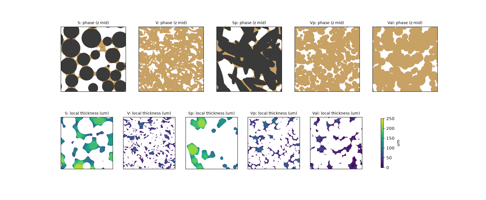
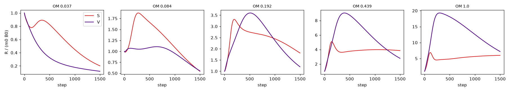
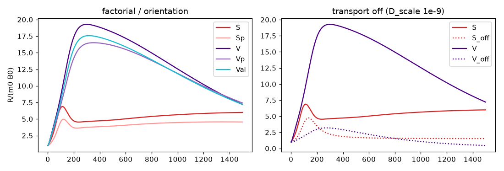

# Stage 21 — 3D packing-based structure (Sand and Vertisol only)

Scope: Sand and Vertisol only; no Loess; no measured data of any kind (no uCT, texture/PARIO, lab data) as input or
validation target. Earlier stages are untouched (`dual_porosity.py`, `model.py`, `stage19_run.py`, `stage20_run.py`,
`configs/*` unmodified; biology file byte-identical).
New code: `packing3d.py` (structure), `model3d.py` (engine), `stage21_run.py` (Steps 0–2), `stage21_steps34.py` (Steps 3–4).
Raw outputs: `results/stage21/` (`step0..4.json`, per-run `runs/*.json|npz`, figures).

## Pre-flight
- 2x NVIDIA RTX A6000 (46 GB); CuPy 14.2 (cuda12x) installed and working. All array ops go through `xp` (cupy or numpy).
- float64 everywhere (no float32 used, so no float32-vs-float64 check needed). Full 5 um / 256^3 runs done on GPU; no 10 um pilot needed.
- Engine: Jacobi-preconditioned CG (rtol 1e-9) + exact mass rescale; fused CUDA kernels (CG matvec/update, exchange, growth).
  1500 steps: ~215 s (S) / ~320 s (V) per run.

## Step 0 — code validation (passed; re-run on final code)
- 3D point source: mass error 1e-16 (CG) / 1.7e-13 (Jacobi); isotropy spread 5e-16; CG vs Jacobi 4e-11 abs.
- Extrusion test (Stage 20 A1 grids, n=40, OM 0.439, OLD rules: one-way leak, region-max sizing, coating, cluster bonuses; extruded
  in z, `z_diffusion=False`): relative difference to the 2D result 3.7e-16 (max-norm, GPU and CPU, both soils; requirement 1e-8).
- Local thickness exact on a d=40 um sphere (39 um, see quantization note) and a 3-voxel slab (3.0); K(d), D(d) match `pore_field` to 1e-16.

## Structure parameters (fixed from literature BEFORE any respiration run; never adjusted)
Honest labelling: items marked **[assumed]** are design choices constrained by, but not directly given in, the cited literature.

| Parameter | Value | Source / status |
|---|---|---|
| Sand grain size | lognormal in phi, median 250 um (fine-to-medium sand), sigma_phi = 0.5, truncated 100–500 um | USDA size classes (Soil Survey Manual, USDA Handbook 18, 2017); sorting Folk & Ward 1957 ("moderately well sorted" limit) **[sigma, median chosen within class]** |
| Sand solid fraction | 0.60 | RCP of spheres ~0.64 (Scott 1960; Torquato, Truskett & Debenedetti 2000); bulk density 1.6 / particle density 2.65 g cm^-3 gives 0.60 |
| Sand packing algorithm | periodic Jodrey–Tory-style compression/relaxation of spheres; contacts allowed; max overlap 0.2% of mean diameter; 110 grains | standard collective-rearrangement method, documented here |
| Sand fines | silt 4%, clay 3% (silt + 1.5 clay = 8.5% < 15%, USDA "sand" class); mass fraction 0.07, internal porosity 0.45 -> matrix volume fraction 0.082 | USDA texture triangle (Soil Survey Manual 2017); **[fines mass split and internal porosity 0.45 assumed]**. Placed in pore voxels of smallest local thickness first (ties: distance to wall, then random) |
| Vertisol clay | >= 30% clay, platy/lenticular peds, microaggregates < 250 um | Keys to Soil Taxonomy (2014); Soil Survey Manual 2017; Tisdall & Oades 1982 |
| Vertisol plates | oblate discs, aspect ratio 4, median diameter 160 um, GSD 1.3, truncated 80–250 um, random orientation; union of plates = porous matrix | **[sizes/aspect assumed within cited class bounds]** |
| Vertisol resolved porosity | 0.25 | **[assumed; no direct source]**. Plates placed as a penetrable Boolean population until it is reached |
| S' | equal-volume plates (4:1) + same inert-solid fraction 0.60 + same fines (Boolean placement) | factorial design |
| V' | equal-volume spheres at the same centres as V's plates, porous matrix | factorial design |
| V_al | V's plates and centres, normals aligned to z | orientation control |

Inherited, flagged, not tuned: biology.yaml (byte-identical), D_of_d constants, D_scale 12.2582, k_matrix_diff 0.03, **k_ex 0.10 (inherited
from k_leak)**, film K scale 0.45, d_cut 50 um, K plateau (150 um)/decay, habitat lower limit 10 um, T=1500, dt=0.05.
Local thickness: Hildebrand & Ruegsegger 1997, EDT-based (own implementation, 0.25-voxel radius levels). Wetting film: Millington & Quirk 1961, S_w^(10/3).
Two-way exchange: van Genuchten & Wierenga 1976. Known quantization: diameter = 2*rho - 1 voxels, so even widths read 1 voxel (5 um) low;
the 10 um habitat threshold is effectively 10–15 um.
Densities (fixed, asserted each run, N = 256^3): sum(OM) = OM_density N (uniform per matrix volume), sum(B0) = 0.0125 N, sum(K) = K_density N,
K_density = mean of the two soils' native K densities = 0.16445 (S 0.13702, V 0.19189). B0 proportional to K.

## Step 1 — geometry (256^3, 5 um, seed offset 0; predictions committed first in `STAGE21_STEP1_PREDICTIONS.md`)
Predictions were informed by a 10 um geometry-only check (no respiration).

| | S | V | S' | V' | V_al |
|---|---|---|---|---|---|
| Resolved porosity | 0.318 | 0.250 | 0.316 | 0.247 | 0.249 |
| Matrix fraction | 0.082 | 0.750 | 0.082 | 0.753 | 0.751 |
| Solid fraction | 0.60 | 0 | 0.602 | 0 | 0 |
| LT d10 / d50 / d90 (um) | 77.5 / 125 / 202.5 | 7.5 / 35 / 65 | 97.5 / 160 / 272.5 | 15 / 45 / 80 | 7.5 / 30 / 65 |
| Largest pore cluster | 0.995 | 0.979 | 0.939 | 0.9985 | 0.998 |
| Spans x,y,z | all | all | all | all | all |
| S_w | 0.215 | 0.941 | 0.207 | 0.896 | 0.950 |
| Habitat volume (fraction of domain) | 0.318 | 0.224 | 0.316 | 0.234 | 0.220 |
| Wet fraction of habitat | 0.012 | 0.738 | 0.0004 | 0.553 | 0.771 |
| OM within 20 um of a pore (diagnostic) | 0.588 | 0.591 | 0.413 | 0.396 | 0.569 |

Gate passed (S and V span all three axes; habitat 32% / 22% >> 1%). Central slices: 

Reading: Sand is a wide-open, almost entirely drained network (film transport only) with a thin wet fines matrix; Vertisol is a fine, mostly wet
network (diffusion-dominated). The regime split arises from the 50 um matric rule on the packed geometry, not from a per-soil rule.

## Step 2 — regime map (S and V, seed 0)
Primary = B_peak/B0 > 1 AND R_peak >= 2 m0 B0 AND growth share > 50%. Secondary = R-only.

| OM | S-V distance | Primary both | Secondary both | S: B_pk/B0, Rpk/floor, growth | V: B_pk/B0, Rpk/floor, growth |
|---|---|---|---|---|---|
| 0.037 | 0.378 | no | no | 1.0, 1.0, 0 | 1.0, 1.0, 0 |
| 0.084 | 0.245 | no | no | 1.0, 1.88, 0.76 | 1.0, 1.11, 0.77 |
| 0.192 | 0.339 | no | yes | 1.0, 3.3, 0.79 | 1.0, 3.6, 0.78 |
| 0.439 | 0.909 | yes | yes | 1.63, 5.08, 0.82 | 2.04, 9.04, 0.80 |
| **1.0** | **1.229** | yes | yes | 2.71, 6.88, 0.85 | 4.66, 19.3, 0.82 |

Selected OM_density = 1.0 (both PRIMARY-alive, highest distance). Peak time (fraction of run): S 0.075, V 0.199; R_end/R_peak: S 0.87, V 0.37.
Distances at low OM are driven by dead/marginal runs (B only decays) and are not meaningful.
Delivery split at OM 1.0 (net substrate delivered into habitat, model units):

| | wet habitat | drained habitat |
|---|---|---|
| S diffusion | 8.3e5 | 3.3e6 |
| S exchange | 8.1e4 | 2.65e6 |
| V diffusion | 1.17e7 | 8.5e5 |
| V exchange | 6.1e5 | 2.2e4 |

Sand is supplied in the drained habitat by film diffusion plus matrix exchange; Vertisol by wet-pore diffusion. Mass balance ~1e-16 in all runs. 

## Step 3 — distinctness at OM 1.0 (one run each): PASSED
S-V distance **1.229** (> 0.3), both PRIMARY-alive.

(a) Factorial (distance on R_t):

| Contrast | Distance |
|---|---|
| shape effect, sand material (S vs S') | 0.073 |
| shape effect, vertisol material (V' vs V) | 0.037 |
| material effect, sphere shape (S vs V') | 1.153 |
| material effect, plate shape (S' vs V) | 1.049 |
| off-diagonal (S' vs V') | 0.951 |
| total (S vs V) | 1.229 |

Distinctness is almost entirely a **material/structure-partition effect** (matrix fraction, fines vs porous aggregates, resulting
resolved pore-size scale and wet/drained split); particle shape alone moves the curves by <= 0.07. Caveat: S' differs from S in placement algorithm
(Boolean vs hard-sphere) as well as shape, so the shape effect is not perfectly isolated.

(b) Orientation: V vs V_al distance 0.010 (V_al vs S 1.20). Arrangement at fixed particles has negligible effect here.
Unlike the Stage 20 pixel-shuffle, this control is physically valid (same particles, intact aggregates) and shows the result is not a rearrangement artefact.

(c) Transport off (D_scale 1e-9; exchange stays on; this also scales matrix D): primary liveness lost in both soils (B does not grow); R_peak falls to 69% (S) and 17% (V) of baseline;
S vs S_off 1.04, V vs V_off 0.29, S_off vs V_off 0.61. Vertisol depends much more on diffusion; Sand retains substantial respiration via matrix exchange.
Distinctness persists without diffusion, driven by the structure/exchange partition. 

## Step 4 — seed robustness (3 packing seeds per soil, OM 1.0): PASSED
- Within-soil seed-pair distances: S 0.006 / 0.089 / 0.109; V 0.003 / 0.0015 / 0.0011.
- Noise (max) 0.109 vs minimum between-soil distance 1.207: noise < 0.5 x between (0.109 < 0.60). All 6 runs PRIMARY-alive; all 9 cross-seed S–V pairs 1.21–1.24.
- Max mass-balance error across runs 8e-15.

## Verdict
Under the pre-registered rules, a fixed-literature 3D packing (no per-soil OM/coating/leak rules; equal per-voxel totals) produces two soils that are both alive
(primary), distinct (1.23, seed noise 0.11), and robust to packing seed; the geometry gate and mass conservation hold. The distinct regimes
(Sand: drained film + exchange; Vertisol: wet-pore diffusion) emerge from structure alone. The earlier problems are removed structurally: 3D percolating pore networks, per-voxel local thickness
(no all-or-nothing regions; Sand no longer a single 340 um region), two-way exchange replacing the leak, no coating fraction.

Limitations (not rescued): (1) distinctness is a material-partition effect; shape/orientation contribute ~0.01–0.07, so "arrangement" in the packing sense is not what separates the soils.
(2) Vertisol resolved porosity (0.25), plate size/aspect and fines internal porosity/split are assumed design values, not directly sourced.
(3) S' / V / V_al use Boolean placement while S uses hard-sphere packing (algorithm confound in the factorial). (4) Local thickness quantization (half-voxel) and effective 10–15 um habitat threshold.
(5) Steps 2–3 use one seed; OM_density = 1.0 is the top of the mapped range, so the optimum may lie beyond it (the map was not extended; no tuning beyond the specified grid).
(6) Alive-ness at OM 1.0 depends on K_density and inherited k_ex = 0.10, which were not tuned. (7) No measured data was used, so nothing here is validated against real soil.

## Run times
Step 0 ~53 s; Step 1 ~67 s (all 5 structures, 256^3); Step 2 ~25 min wall (10 runs on 2 GPUs); Step 3 504 s (7 runs on 2 GPUs); Step 4 586 s (6 runs on 2 GPUs).
