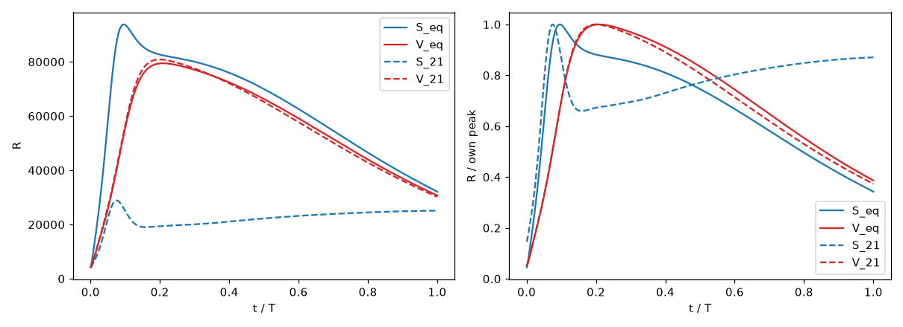

# Stage 22 — Equal habitat-scale wetting (50% of resolved pores wet in both soils)

Scope: Sand and Vertisol only; no Loess; no measured data of any kind. Single change vs Stage 21: the wetting rule
(`wetting="equal50"` switch in `model3d.py`, default `"matric"` = Stage 21). Same packings (seed 0), structure, habitat (LT >= 10 um),
k_ex 0.10, k_matrix_diff 0.03, D constants, D_scale, biology (byte-identical), OM 1.0, B0 0.0125, K_density 0.16445 (Stage 21 value kept),
T 1500, dt 0.05, 256^3 at 5 um, float64, 2x RTX A6000. Code: `stage22_run.py`; outputs `results/stage22/`.

Rule: matrix always wet; resolved pore voxels exactly 50% wet, ascending local thickness (ties broken by a fixed-seed random key so a
partially filled LT level is not a spatial slab); solid never wet. Drained film D = D(LT) x D_scale x f_rel, f_rel = 0.5^(10/3) = 0.0992 in both soils
(S_w = resolved-pore saturation). Film K scale 0.45 on drained habitat unchanged. The wet count is round(0.5 x pore voxels): 0.5000001 (Sand), 0.5 (Vertisol).

## Step 0 — wetting map (no respiration)

| | Sand, Stage 21 | Sand, equal-50 | Vertisol, Stage 21 | Vertisol, equal-50 |
|---|---|---|---|---|
| Wet fraction of resolved pores | 0.0124 | 0.5000 | 0.765 | 0.5000 |
| Wet fraction of HABITAT (LT >= 10 um) | 0.0122 | 0.4999 | 0.738 | **0.443** |
| Film S_w used | 0.215 (voxel-based) | 0.5 (pore) | 0.941 (voxel-based) | 0.5 (pore) |
| f_rel | 0.0060 | 0.0992 | 0.817 | 0.0992 |
| Voxel S_w (reference) | 0.215 | 0.603 | 0.941 | 0.875 |
| Effective air-entry diameter (um) | 47.5 | 125 | 47.5 | 35 |
| Young–Laplace psi (kPa, sigma 0.072 N/m) | -6.1 | -2.3 | -6.1 | -8.2 |
| Native K density (before rescale) | 0.137 | 0.222 | 0.192 | 0.156 |

Vertisol habitat wet fraction is below 0.5 because its sub-10 um pores (non-habitat) fill first; not corrected. K_density (0.16445) stays fixed; the native
K densities shift as shown (the 0.45 film K scale now applies to a different habitat share), and the rescale to the common density absorbs this.
Note that "equal wetting" means different suctions: Sand at -2.3 kPa, Vertisol at -8.2 kPa.
OFF-switch check: with the switch unset, S and V at OM 1.0 seed 0 reproduce the Stage 21 runs bit-for-bit (max relative error 0.0 in R and B).
Prediction was committed before the runs (`STAGE22_PREDICTIONS.md`): soils move toward each other; distance well below 1.229 but >= 0.3 (expected); collapse possible.

## Step 1 — S_eq and V_eq, OM 1.0, seed 0

| | S_eq | V_eq | S_21 | V_21 |
|---|---|---|---|---|
| B_peak/B0 | 6.15 | 4.71 | 2.71 | 4.66 |
| R_peak/(m0 B0) | 22.4 | 18.9 | 6.88 | 19.3 |
| growth share at peak | 0.875 | 0.808 | 0.846 | 0.815 |
| peak time (t/T) | 0.095 | 0.209 | 0.075 | 0.199 |
| R_end/R_peak | 0.342 | 0.387 | 0.871 | 0.373 |
| fuel remaining | 0.0235 | 0.0235 | 0.0235 | 0.0235 |
| PRIMARY / SECONDARY alive | yes / yes | yes / yes | yes / yes | yes / yes |
| diffusion -> wet habitat | 1.18e7 | 1.05e7 | 8.3e5 | 1.17e7 |
| diffusion -> drained habitat | 1.67e6 | 1.91e6 | 3.31e6 | 8.5e5 |
| exchange -> wet habitat | 5.8e5 | 5.7e5 | 8.1e4 | 6.1e5 |
| exchange -> drained habitat | 1.4e2 | 2.1e5 | 2.65e6 | 2.2e4 |
| mass balance (rel.) | 8e-16 | 3e-16 | 1e-15 | 2e-16 |
Run time: S_eq 329 s, V_eq 171 s (parallel on two GPUs).

Distances (Stage 19/20/21 metric on R(t)):

| Pair | Distance |
|---|---|
| **S_eq vs V_eq** | **0.193** |
| S_eq vs S_21 | 1.103 |
| V_eq vs V_21 | 0.010 |
| S_eq vs V_21 | 0.170 |
| V_eq vs S_21 | 1.205 |
| (S_21 vs V_21) | 1.229 |

Figure (absolute and normalised R(t), Stage 21 as dashed reference): 

### Pre-registered reading
S_eq vs V_eq = 0.193 < 0.3 -> **Stage 21's distinction was carried by the wetting asymmetry.** Both soils stay PRIMARY-alive under equal wetting, but they become
nearly indistinguishable. The movement is almost entirely one-sided: Sand moved onto Vertisol's curve (S_eq is 0.17 from V_21), while Vertisol's curve is essentially
unchanged (0.010) even though its film factor fell 8x and its wet habitat share changed 74% -> 44% — its R is dominated by wet-pore diffusion into the large wet share of
habitat, which stays wet-dominated, so it is insensitive to the film. Sand, previously supplied through drained film plus exchange (exchange into drained habitat 2.7e6), now
gets 50% wet habitat and a 17x stronger film; diffusion dominates and exchange into drained habitat nearly vanishes (1.4e2). Sand with a thin matrix (8%) and Vertisol with a thick one (75%)
then give almost the same respiration curve at the same total OM, K and B0.

Step 2 (seed robustness, shape factorial) was skipped per the pre-registered gate (it applies only when S_eq vs V_eq >= 0.3).

## Verdict
Under equal 50% wetting, with everything else identical, the two soils are alive but not distinct (0.193 < 0.3; one seed, so seed noise was not measured — Stage 21's seed noise for
Sand was up to 0.11, which is not negligible relative to 0.19, but the point estimate is also far from Stage 21's 1.23). The Stage 21 separation (1.229) was therefore principally the
matric 50 um switch acting on different pore-size scales, not material properties (matrix fraction, OM location) acting through the same wetting. Residual 0.19 may be real or within seed noise; this was not tested.
Caveats: equal wet fraction means unequal suction (Sand -2.3 kPa vs Vertisol -8.2 kPa); one seed; the film factor change was imposed also on the film K
scale through the shifted drained-habitat set; no rescue attempted, no tuning of the 50% saturation or f_rel.

## Run times
Step 0 ~281 s (two OFF-reproduction runs of ~200–320 s in parallel plus maps); Step 1 332 s wall.
